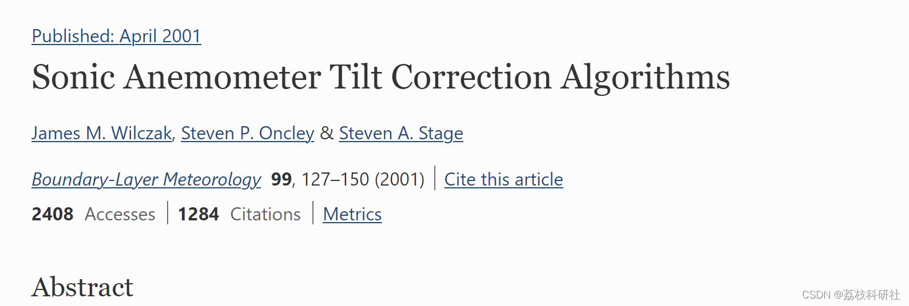
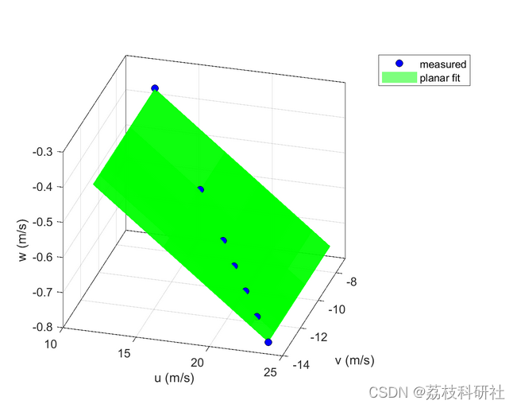
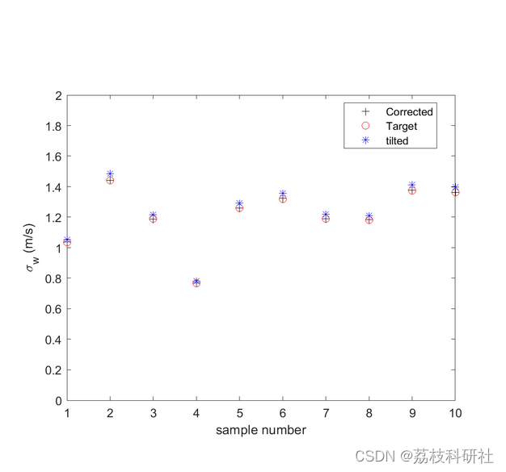
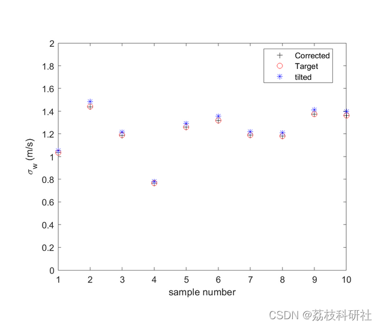
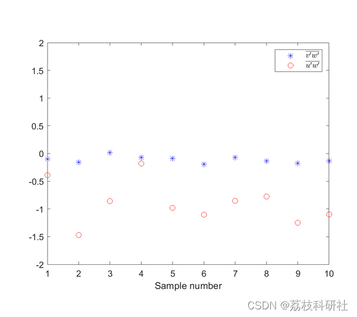
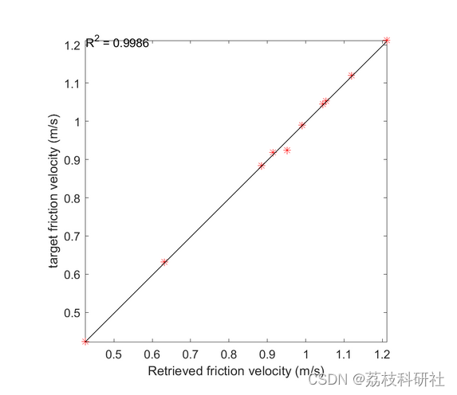

# Implementation of three different algorithms to retrieve three wind components from a tilting anemometer using Matlab

​  
This submission includes: 4 example files: one for plane fitting algorithm, one for double rotation, one for triple rotation, and one for estimating friction speed using different retrieval algorithms.
Function Slope Correction.m
Function friction_velocity.m
The file data.mat contains simulated wind data.
References:
Editor
Download link: Sonic Anemometer Tilt Correction Algorithms | SpringerLink📚2 Run results edit
Editor
Editor
Editor
Editor
Part of the code:
clearvars;close all;clc;  
% load simlated wind velocities  
load('data.mat','u','v','w','t')  
[M,N]=size(u);  
yaw = 30; % yaw angle (horizontal plane, between u and v)  
elev = 3; % elevation angle (vertical plane, between w and u)  
incl = 2; % inclination angle (vertical plane, between w and v)  
R1 = [cosd(yaw),-sind(yaw),0;sind(yaw),cosd(yaw),0;0,0,1]; % matrix rotation around axis z  
R2 = [cosd(elev),0,-sind(elev);0,1,0;sind(elev),0,cosd(elev)]; % matrix rotation around axis zy  
R3 = [1,0,0; 0,cosd(incl),-sind(incl);0,sind(incl),cosd(incl)]; % matrix rotation around axis x  
A = R1*R2*R3; % 3D rotation matrix  
% Construction of tilted velocity component  
u_tilted = zeros(size(u));  
v_tilted = zeros(size(u));  
w_tilted = zeros(size(u));  
for ii=1:M,  
dummy = A\[u(ii,:);v(ii,:);w(ii,:)];  
u_tilted(ii,:) = dummy(1,:);  
v_tilted(ii,:) = dummy(2,:);  
w_tilted(ii,:) = dummy(3,:);  
end  
clearvars;close all;clc;  
% load simlated wind velocities  
load('data.mat','u','v','w','t')  
[M,N]=size(u);  
yaw = 30; % yaw angle (horizontal plane, between u and v)  
elev = 3; % elevation angle (vertical plane, between w and u)  
incl = 2; % inclination angle (vertical plane, between w and v)  
R1 = [cosd(yaw),-sind(yaw),0;sind(yaw),cosd(yaw),0;0,0,1]; % matrix rotation around axis z  
R2 = [cosd(elev),0,-sind(elev);0,1,0;sind(elev),0,cosd(elev)]; % matrix rotation around axis zy  
R3 = [1,0,0; 0,cosd(incl),-sind(incl);0,sind(incl),cosd(incl)]; % matrix rotation around axis x  
A = R1*R2*R3; % 3D rotation matrix  
% Construction of tilted velocity component  
u_tilted = zeros(size(u));  
v_tilted = zeros(size(u));  
w_tilted = zeros(size(u));  
for ii=1:M,  
dummy = A\[u(ii,:);v(ii,:);w(ii,:)];  
u_tilted(ii,:) = dummy(1,:);  
v_tilted(ii,:) = dummy(2,:);  
w_tilted(ii,:) = dummy(3,:);  
end  
🌈3 Matlab code implementation
🎉4 References
​  

## Images

<!-- PAYMENT_BLOCK -->

## Get this dataset

- Payment link (Stripe): [Buy now](https://buy.stripe.com/3cs8yP7sY87d0vu9AB)
- Payment QR code: 

<!-- /PAYMENT_BLOCK -->
